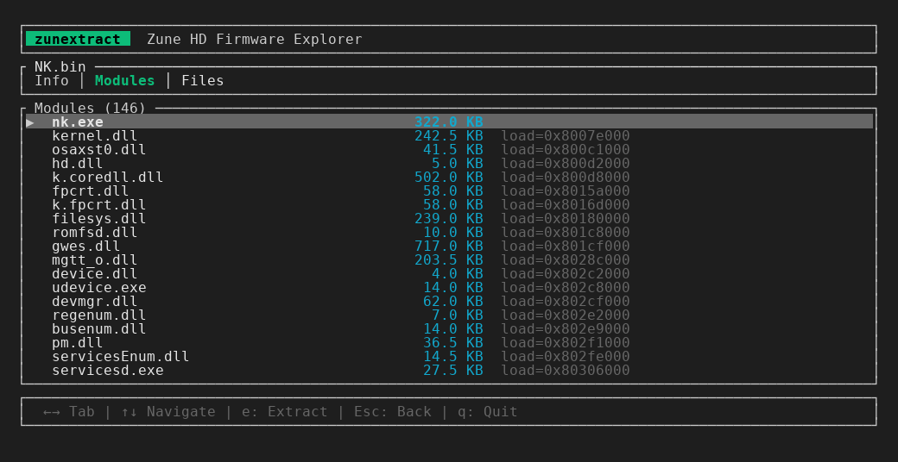

# zunextract

A command-line tool for extracting files from Zune HD (Windows CE 6.0) firmware images.

Handles the full firmware pipeline: **CAB → B000FF BIN → NB0 → Windows CE XIP ROM** — extracting modules (DLLs/EXEs) and data files, with PE reconstruction and **CECompress (LZX) decompression**.

## TUI Explorer



Browse firmware contents interactively with the built-in terminal UI.

## Installation

```bash
cargo install --path .
```

## Usage

### Extract everything from a firmware file

Automatically detects the format (CAB, BIN, or NB0) and extracts all contents:

```bash
zunextract extract firmware.cab -o output/
```

### Show firmware info

```bash
zunextract info firmware.cab
```

### Interactive explorer

```bash
zunextract explore firmware.cab
```

**Controls:** `↑↓` navigate, `Enter` open, `←→` switch tabs, `e` extract, `q` quit.

### Individual stages

```bash
# Extract BIN files from CAB only
zunextract cab firmware.cab -o output/

# Decompress a B000FF BIN to raw NB0
zunextract bin image.bin -o image.nb0

# Extract files from a decompressed NB0 ROM image
zunextract rom image.nb0 -o output/
```

## Firmware Format

Zune HD firmware uses a layered format:

1. **CAB** — Microsoft Cabinet archive containing one or more BIN files
2. **B000FF BIN** — Sparse block format with addressed data blocks and checksums
3. **NB0** — Raw flat binary image (decompressed from BIN)
4. **XIP ROM** — Windows CE ROM filesystem with ECEC signature, ROMHDR, modules (PE executables), and data files

## Tested Firmware

Tested with **Zune HD firmware v4.5** (`PavoBaseline.cab` from `Zune040500109`):

- **SHA-256:** `d6f7f7587845a321f86d1c7df641fb020201c7788666b05d7f74af8c69420cb1`
- 146 modules and 29 files extracted successfully from `NK.bin`
- All 15 CECompress-compressed files decompressed correctly
- All compressed PE sections decompressed without errors

## Limitations

- Only standard XIP ROM images are supported (ECEC signature required)

## License

MIT
